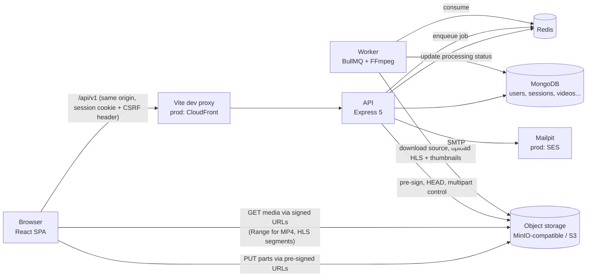

# Phase 0: Environment Inspection, Architecture and Implementation Plan

Status: approved (2026-11-09)

## 1. Environment inspection results

Raw reports: `E:\Jenkins\ViShark\phase0\windows-report.txt` and `wsl-report.txt` (kept outside the repo because they describe the machine).

### Host (Windows)

| Item           | Finding                                                        | Assessment                                                           |
| -------------- | -------------------------------------------------------------- | -------------------------------------------------------------------- |
| OS             | Windows 11 Home, build 26200, x64                              | OK                                                                   |
| CPU            | AMD Ryzen 5 3500U, 4 cores / 8 threads, virtualization enabled | OK; FFmpeg transcodes will be slow-ish but fine for short test clips |
| RAM            | 13.9 GB total                                                  | OK                                                                   |
| Disk           | C: 54 GB free, D: 115 GB, E: 58 GB, F: 14 GB                   | OK; see section 1.4                                                  |
| WSL            | WSL 2.6.3, kernel 6.6.87, default distro Ubuntu (WSL 2)        | OK                                                                   |
| `.wslconfig`   | not present (WSL defaults: 50% RAM, all CPUs)                  | OK for now                                                           |
| Windows Node   | v20.10.0 on Windows PATH                                       | Not used; leaks into WSL PATH (see 1.3)                              |
| Windows Docker | not installed                                                  | Expected; Docker runs inside WSL                                     |
| Reserved ports | 2869, 50000 to 50059, 61539 to 62338                           | Avoid these ranges                                                   |

### WSL Ubuntu

| Item             | Finding                                                                                    | Assessment                                            |
| ---------------- | ------------------------------------------------------------------------------------------ | ----------------------------------------------------- |
| Distro           | Ubuntu 22.04.4 LTS, systemd enabled                                                        | OK                                                    |
| Resources        | 8 vCPU, 6.7 GB RAM, 2 GB swap                                                              | OK; monitor when the other stack is running           |
| Node             | v12.22.9 (apt)                                                                             | **Too old. Install Node 26 via nvm**                  |
| nvm              | present                                                                                    | Will be used                                          |
| pnpm             | not installed                                                                              | **Install**                                           |
| Git              | 2.34.1, identity configured                                                                | OK                                                    |
| FFmpeg / FFprobe | not installed                                                                              | **Install** (needed when running the worker natively) |
| Docker           | Engine 29.1.3 native in WSL (not Docker Desktop), socket activated, user in `docker` group | OK, `hello-world` succeeded                           |
| Compose          | v5.1.3                                                                                     | OK                                                    |

### 1.3 Issues found

1. **Docker cold start**: `docker.service` is socket activated, so the first Docker command after boot waits while dockerd starts and restarts existing containers. Not a fault. Our scripts will wait for the daemon with a timeout instead of hanging.
2. **Windows PATH leaking into WSL**: `corepack` resolved to `/mnt/c/Program Files/nodejs/corepack` and failed with a CRLF error. Installing Node and pnpm inside WSL shadows the Windows binaries, which is enough. Optionally set `appendWindowsPath=false` in `/etc/wsl.conf` (side effect: `code .` needs an alias).
3. **Port conflicts with an existing stack**: 3000, 5000, 5173, 5432, 8000, 8080, 8081, 9100 and 3306 are already in use. StreamHub uses its own port plan (section 4).

### 1.4 Disk assessment

- Repo on E: (58 GB free): expected footprint 3 to 5 GB including `node_modules`.
- Docker images, volumes and the WSL `ext4.vhdx` live on C: (54 GB free): expected 10 to 15 GB. The vhdx grows and does not shrink automatically; `scripts/clean` and periodic compaction will be documented.
- Verdict: no disk exhaustion risk for this project.

## 2. Version selection (verified 2026-11-09)

| Component                             | Version                                | Notes                                                                                         |
| ------------------------------------- | -------------------------------------- | --------------------------------------------------------------------------------------------- |
| Node.js                               | **26.x LTS (26.13.0)**                 | Node 26 entered Active LTS on 2026-10-28. All critical dependency `engines` ranges accept it. |
| pnpm                                  | 12.18.0                                | Installed with `npm i -g`. Corepack is no longer bundled with Node 25+.                       |
| TypeScript                            | **6.0.3 (pinned)**                     | TypeScript 7.0 exists, but typescript-eslint 8.72 supports `<6.1.0`. Revisit later.           |
| Express                               | 5.3.0                                  | Native async error handling                                                                   |
| Mongoose                              | 9.12.x                                 |                                                                                               |
| Zod                                   | 4.6.x                                  | Shared schemas for API and web                                                                |
| argon2                                | 0.45.2                                 | N-API prebuilt binaries, ABI stable across Node versions                                      |
| BullMQ / ioredis                      | 6.7.x / 6.0.x                          |                                                                                               |
| AWS SDK v3 S3                         | 3.1165.x                               | `client-s3` + `s3-request-presigner`                                                          |
| Pino / pino-http                      | 10.4 / 11.0                            |                                                                                               |
| Helmet                                | 8.3                                    |                                                                                               |
| express-session / connect-mongo       | 1.19 / 6.0                             |                                                                                               |
| express-rate-limit                    | 8.7                                    | Redis store so limits hold across instances                                                   |
| Nodemailer                            | 10.4                                   | Mailpit locally                                                                               |
| otplib                                | 13.6                                   | Admin TOTP                                                                                    |
| prom-client                           | 15.1                                   | Prometheus metrics                                                                            |
| React / Vite                          | 19.3 / 8.3                             |                                                                                               |
| React Router / TanStack Query         | 8.5 / 5.107                            |                                                                                               |
| hls.js                                | 1.7.4                                  |                                                                                               |
| Vitest / Supertest / RTL / Playwright | 5.1 / 7.3 / 16.3 / 1.65                |                                                                                               |
| ESLint / Prettier                     | 10.14 / 3.9                            |                                                                                               |
| MongoDB                               | 8.x Community, single node replica set | exact tag pinned in Phase 1                                                                   |
| Redis                                 | 8.x                                    | exact tag pinned in Phase 1                                                                   |
| Object storage                        | **pgsty/silo** (MinIO fork)            | ADR-005                                                                                       |
| Mailpit                               | latest stable, pinned in Phase 1       |                                                                                               |

Exact versions are locked in `pnpm-lock.yaml`; container images are pinned by tag in Phase 1.

## 3. Proposed architecture



### Components and how they talk

| Component      | Responsibility                                                                             | Talks to                                                       |
| -------------- | ------------------------------------------------------------------------------------------ | -------------------------------------------------------------- |
| `apps/web`     | React SPA, all user and admin pages                                                        | API over same origin; storage directly for upload and playback |
| `apps/api`     | Auth, sessions, RBAC, metadata, upload orchestration, playback authorization, admin, audit | MongoDB, Redis, storage control plane, SMTP                    |
| `apps/worker`  | Verify, probe, transcode to HLS, thumbnails, status updates, retries                       | Redis (BullMQ), storage, MongoDB                               |
| MongoDB        | System of record                                                                           |                                                                |
| Redis          | BullMQ queues, rate limit counters                                                         |                                                                |
| Object storage | Private buckets: `uploads` (originals) and `media` (HLS, thumbnails)                       |                                                                |
| Mailpit        | Captures verification and reset emails locally                                             |                                                                |

### Key flows

**Upload**: admin submits metadata and file info, API validates and creates `uploads` + `videos` records, starts a multipart upload with a generated key, returns short-lived pre-signed part URLs. The browser uploads parts directly to storage, then calls `complete`. The API verifies existence, size and ETags, reads the first bytes to check the file signature, moves state to `VERIFYING` and enqueues a job.

**Processing**: the worker downloads the source to a temp dir, runs `ffprobe` (fixed args, `execFile`, timeout), generates 360p/720p/1080p renditions only up to the source height, a master playlist and thumbnails, uploads them to the `media` bucket and sets `READY` or `FAILED` with retries.

**Playback**: `GET /videos/:id/playback` checks the session and access rules, then asks a `PlaybackUrlProvider` for URLs. Locally it returns a pre-signed MP4 URL (storage serves `Range` requests with `206`), or an API-served HLS playlist whose segment lines are rewritten to individually pre-signed URLs, so every segment is authorized. On AWS the same interface is implemented with CloudFront signed cookies scoped to `/videos/{id}/*`.

**Sessions**: opaque random session ID in an HttpOnly cookie, session data in MongoDB, regenerated on login, idle and absolute timeouts enforced server side, CSRF synchronizer token sent as a header.

## 4. Port plan (all bound to 127.0.0.1)

| Service                         | Port        | Why           |
| ------------------------------- | ----------- | ------------- |
| Web (Vite dev)                  | 5273        | 5173 is taken |
| API                             | 4000        | 3000 is taken |
| Worker health/metrics           | 4100        |               |
| MongoDB                         | 27017       | free          |
| Redis                           | 6379        | free          |
| Object storage S3 API / console | 9000 / 9001 | free          |
| Mailpit SMTP / UI               | 1025 / 8025 | free          |

All ports are configurable through `.env`. Binding to 127.0.0.1 matters because Docker's published ports bypass host firewall rules; `0.0.0.0` would expose MongoDB to your network.

## 5. Implementation roadmap

| Phase | Deliverable                                                                    | Acceptance criteria                                                                                                                       |
| ----- | ------------------------------------------------------------------------------ | ----------------------------------------------------------------------------------------------------------------------------------------- |
| 0     | Environment report, architecture, plan, ADRs                                   | You approve this document                                                                                                                 |
| 1     | Monorepo, TS, lint/format, Compose with MongoDB, Redis, storage, Mailpit       | `pnpm install` + `pnpm typecheck` + `pnpm lint` pass; all 4 services healthy; connectivity script passes                                  |
| 2     | Express app, config validation, logging, errors, health, OpenAPI               | `/health/live` and `/health/ready` correct when Mongo is up and down; config fails fast on bad env; request IDs in logs; Swagger UI loads |
| 3     | Auth, sessions, email verify, reset, RBAC, CSRF, rate limits, admin CLI        | Integration + security tests pass, including session fixation, CSRF, enumeration and brute force cases                                    |
| 4     | Categories, videos, uploads, storage abstraction, pre-signed multipart         | Upload of a real file to storage end to end via API tests; invalid transitions rejected; abort and expiry work                            |
| 5     | MP4 playback, range support, playback authorization, watch history, favourites | `206` with correct `Content-Range`; unauthorized and expired URLs rejected; resume position saved                                         |
| 6     | Worker, FFprobe, HLS, thumbnails, BullMQ retries, failure handling             | Sample video becomes `READY` with correct renditions and no upscaling; corrupt file ends `FAILED`                                         |
| 7     | Frontend pages                                                                 | Component tests pass; pages handle loading, empty, error and expired session states                                                       |
| 8     | Full integration                                                               | Every user and admin workflow works manually and via scripts                                                                              |
| 9     | Security and performance validation                                            | Unit, integration, Playwright and security suites green; `pnpm audit` and image scans with no unresolved critical/high                    |
| 10    | Docs, diagrams, AWS runbook, clean install, final reports                      | Fresh clone to running app using only the README                                                                                          |

## 6. Proposed file structure

Follows the spec, with two adaptations (ADR-008):

```
streamhub/
├── apps/
│   ├── web/                 React + Vite
│   ├── api/
│   │   ├── src/
│   │   │   ├── modules/     auth, users, sessions, videos, uploads, categories,
│   │   │   │                favourites, watch-history, admin, audit, health
│   │   │   ├── middleware/  auth, rbac, csrf, validate, rate-limit, request-id, error
│   │   │   ├── config/      zod-validated env
│   │   │   ├── database/    connection, migrations
│   │   │   ├── infrastructure/ storage, mail, queue, playback, metrics, logger
│   │   │   ├── common/      errors, pagination, dto helpers
│   │   │   ├── app.ts       builds the Express app (testable, no listen)
│   │   │   └── server.ts    starts it, graceful shutdown
│   │   └── tests/           unit, integration, security
│   └── worker/
│       ├── src/ processors/ jobs/ ffmpeg/ worker.ts
│       └── tests/
├── packages/
│   ├── contracts/           Zod schemas + inferred types + DTOs (replaces types/ + validation/)
│   └── shared/              constants, video state machine, roles/permissions, utils
├── docker/ api/ web/ worker/  Dockerfiles
├── scripts/                 infra-up/down, dev, logs, reset (confirm), seed, create-admin, wait-for, clean
├── tests/e2e/               Playwright
├── docs/ architecture/ api/ security/ database/ operations/ testing/ aws/
├── docker-compose.yml
├── pnpm-workspace.yaml  package.json  tsconfig.base.json  eslint.config.js
├── .nvmrc  .gitignore  .env.example  README.md
├── ARCHITECTURE_DECISIONS.md
└── DEVELOPMENT_LOG.md
```

## 7. Local software installation checklist (WSL Ubuntu)

Nothing needs installing on Windows. In the Ubuntu terminal:

```bash
# 1. Node 26 LTS via nvm (does not touch the apt Node 12)
nvm install 26
nvm alias default 26
node -v            # expect v26.x

# 2. pnpm (Corepack is not bundled with Node 26)
npm install -g pnpm@12.18.0
pnpm -v            # expect 12.18.0

# 3. FFmpeg + FFprobe for running the worker outside Docker
sudo apt update && sudo apt install -y ffmpeg
ffmpeg -version | head -1

# 4. Confirm the Windows binaries are shadowed
which node pnpm    # both should be under ~/.nvm, not /mnt/c
```

Later, in Phase 9: `pnpm exec playwright install --with-deps chromium`.

Optional, only if memory gets tight with both stacks running: create `C:\Users\<you>\.wslconfig` with `memory=8GB` and `swap=4GB`, then `wsl --shutdown`.

## 8. Decisions taken at review

1. Object storage: `pgsty/silo` (ADR-005).
2. Repo location: `E:\Jenkins\ViShark\streamhub` (ADR-002).
3. Shared packages: `contracts` + `shared` (ADR-008).
